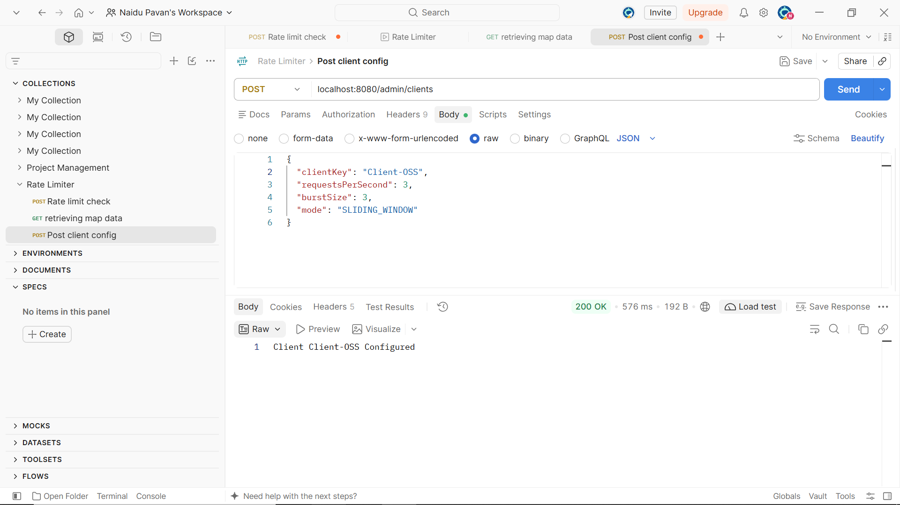

# Rate Limiter Service

A standalone rate-limiting API that other services call to decide whether a request should be allowed or denied. Built with Spring Boot and PostgreSQL.

## Features

- **Two algorithms, chosen per client:** Token Bucket and Sliding Window
- **Per-client limits:** requests per second and burst size, configurable through an admin API
- **Persistent state:** limiter state is stored in PostgreSQL and survives restarts
- **Concurrency safe:** per-client locking prevents tokens from being double-spent
- **Standard headers:** `X-RateLimit-Limit`, `X-RateLimit-Remaining`, `X-RateLimit-Reset` on every response, `429 Too Many Requests` when denied
- **Tests:** unit and integration tests

## Tech stack

Java, Spring Boot, Spring Data JPA, PostgreSQL, Maven

## Run locally

1. Create a PostgreSQL database.
2. Set the environment variables used in `application.properties`: the JDBC URL (`RATELIMITER_DB`), the database username (`DB_USERNAME`) and the database password.
3. Start the app:

```bash
cd ratelimiter
./mvnw spring-boot:run
```

The API runs on `http://localhost:8080`.

## API

### Create a client

```bash
curl -X POST http://localhost:8080/admin/clients \
  -H "Content-Type: application/json" \
  -d '{"clientKey": "my-app", "requestsPerSecond": 5, "burstSize": 10, "mode": "TOKEN_BUCKET"}'
```

`mode` is `TOKEN_BUCKET` or `SLIDING_WINDOW`.


### Get or update a client

```bash
curl http://localhost:8080/admin/clients/my-app

curl -X PATCH http://localhost:8080/admin/clients/my-app \
  -H "Content-Type: application/json" \
  -d '{"requestsPerSecond": 20, "burstSize": 40}'
```

### Check a request

```bash
curl -i -X POST http://localhost:8080/rate-limit/check \
  -H "Content-Type: application/json" \
  -d '{"clientKey": "my-app"}'
```

- `200 OK` — request allowed
- `429 Too Many Requests` — request denied
- `404 Not Found` — unknown client key

Example response body:

```json
{
  "allowed": true,
  "limit": 10,
  "currentTokens": 9,
  "resetAfterSeconds": 0.2,
  "requestsPerSecond": 5,
  "burstSize": 10
}
```

## Run the tests

```bash
cd ratelimiter
./mvnw test
```

## Roadmap

- Redis-backed state for multi-instance deployments
- Authentication on the admin API
- Dashboard with live allowed/denied rates per client
